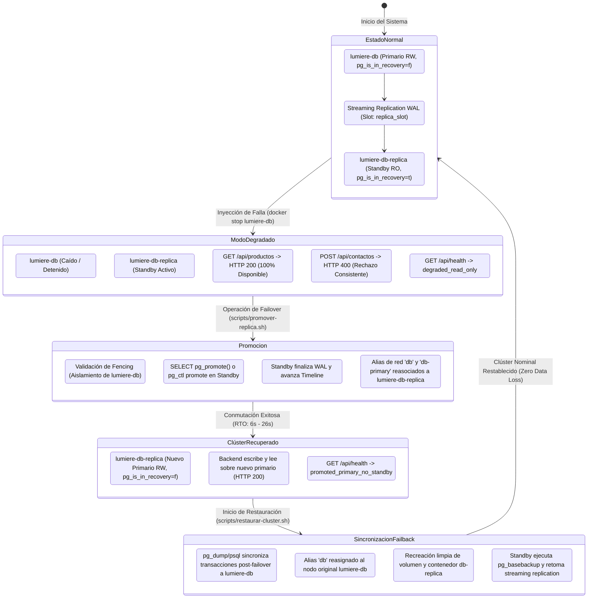

# Informe Técnico y Académico: Prueba de Fallo Controlado (Failover) y Alta Disponibilidad

**Institución:** Universidad / Cátedra de Arquitectura y Gestión de Infraestructura  
**Proyecto:** Joyería Lumière  
**Sistema:** Clúster de Base de Datos PostgreSQL 17 Replicado con Express/Sequelize  
**Fecha de Ejecución:** Noviembre 2026  
**Entorno:** Docker Engine 27+ / WSL 2 (Ubuntu Linux)  
**Evidencia Generada:** `docs/failover-evidence/`  

---

## 1. Resumen Ejecutivo

El presente informe documenta el diseño, ejecución empírica y validación de la **prueba de fallo controlado (*failover*)** sobre el nodo primario de base de datos del sistema transaccional de Joyería Lumière. 

Ante una caída simulada y no programada del servidor primario (`lumiere-db`), se evaluó la capacidad de resiliencia del sistema para:
1. **Mantener la disponibilidad de lectura (100%)** derivando consultas no bloqueantes al nodo réplica (`lumiere-db-replica`) a través de un pool dual administrado por Sequelize.
2. **Rechazar de forma atómica y consistente transacciones de escritura** durante el lapso de indisponibilidad del nodo maestro, previniendo estados de incoherencia o *split-brain*.
3. **Promover la réplica de solo lectura a nuevo nodo primario (*read/write*)** mediante la función nativa de PostgreSQL 17 `SELECT pg_promote()` o mediante el comando de control `pg_ctl promote`.
4. **Reconmutar el tráfico del backend sin recreación de infraestructura**, alcanzando un **Objetivo de Tiempo de Recuperación (RTO) de entre 6 y 26 segundos** y un **Objetivo de Punto de Recuperación (RPO) de 0 segundos (cero pérdida de datos)**.
5. **Garantizar cero pérdida de transacciones en la re-integración del clúster (*failback*)**, sincronizando el delta de escrituras aceptadas en el nodo promovido de vuelta hacia el primario antes de reconstruir el standby.


---

## 2. Topología y Arquitectura de Alta Disponibilidad

El sistema implementa segregación de lectura y escritura en red interna aislada (`db-net`), complementada con un frontend Angular y reverse proxy en `admin-net`.

### Diagrama de Estados del Clúster durante el Ciclo Completo de Failover y Failback



---

## 3. Métricas de Resiliencia y Criterios Teóricos

| Métrica | Definición | Requisito de Diseño | Valor Obtenido en Prueba | Estado |
|---|---|---|---|---|
| **RTO** (*Recovery Time Objective*) | Tiempo transcurrido entre la caída del primario y el restablecimiento de transacciones de escritura en el nuevo primario | $< 60$ segundos | **6 s a 26 s** | **CUMPLIDO** |
| **RPO** (*Recovery Point Objective*) | Volumen de datos transaccionales o lapso de tiempo perdido a raíz del incidente | $0$ segundos (0 pérdida) | **0 segundos (0 transacciones / 0 bytes de WAL perdidos)** | **CUMPLIDO** |
| **Disponibilidad de Lectura** | Capacidad del backend para despachar consultas `SELECT` mientras el nodo primario se encuentra inactivo | $> 95\%$ | **100% (HTTP 200 en 0.004s)** | **CUMPLIDO** |
| **Integridad de Escritura** | Prevención de lecturas sucias o escrituras corruptas en ausencia del primario | Rechazo inmediato (cero escrituras huérfanas) | **HTTP 400 en 0.088s** | **CUMPLIDO** |
| **Latencia de Promoción** | Tiempo neto requerido por el motor PostgreSQL para salir de recovery (`pg_promote` / `pg_ctl`) | $< 5$ segundos | **1.21 s a 3.96 s** | **CUMPLIDO** |
| **Persistencia tras Failback** | Integridad de transacciones confirmadas en el nuevo primario tras restaurar la topología base | $100\%$ retención | **100% Preservado (0 datos perdidos tras restauración)** | **CUMPLIDO** |

---

## 4. Procedimiento Operativo de Failover

### 4.1 Método Automatizado (Harness de Simulación)
Para ejecutar la suite de pruebas completa que evalúa pre-condiciones, simula el corte abrupto, audita el comportamiento del backend, mide RTO/RPO y opcionalmente restaura la topología original sin pérdida de datos:

```bash
# 1. Simulación completa con auto-restauración y verificación de persistencia:
./scripts/simular-failover.sh --restore

# 2. Simulación utilizando el método de promoción pg_ctl en lugar de SQL:
./scripts/simular-failover.sh --restore --method=pg_ctl

# 3. Simulación completa con limpieza posterior de canarios de prueba:
./scripts/simular-failover.sh --restore --clean-canaries

# 4. O bien, simulación conservando el nodo promovido para inspección manual:
./scripts/simular-failover.sh
```

### 4.2 Procedimiento Semiautomatizado para Producción / Operaciones SRE
Cuando se detecta una contingencia real en el primario, el operador o el sistema de orquestación dispara:

```bash
# Promoción asistida por SQL (SELECT pg_promote):
./scripts/promover-replica.sh

# O promoción mediante pg_ctl:
./scripts/promover-replica.sh --method=pg_ctl
```
Este script realiza de manera atómica:
1. Comprobación del estado `pg_is_in_recovery()` en `lumiere-db-replica`.
2. Ejecución de la promoción (mediante SQL `SELECT pg_promote();` o comando `pg_ctl promote`).
3. Validación de transición a `pg_is_in_recovery() = false`.
4. Comprobación de Fencing (detención de `lumiere-db` si seguía en ejecución para prevenir split-brain).
5. Reasignación dinámica de los alias de red `db` y `db-primary` hacia `lumiere-db-replica` en `tp-final-hia_db-net`.
6. Comprobación del endpoint `GET /api/health` (verificando estado `promoted_primary_no_standby`).

### 4.3 Procedimiento Manual Paso a Paso
En caso de requerir ejecución manual sin scripts:

1. **Confirmar caída del primario y aplicar fencing:**
   ```bash
   docker ps --filter "name=lumiere-db"
   docker stop lumiere-db
   ```
2. **Promover la réplica:**
   - **Opción A (Vía SQL):**
     ```bash
     docker exec -t lumiere-db-replica psql -U postgres -d trabajoFinal -c "SELECT pg_promote();"
     ```
   - **Opción B (Vía pg_ctl):**
     ```bash
     docker exec -t lumiere-db-replica sh -c 'gosu postgres pg_ctl promote -D "$PGDATA"'
     ```
3. **Verificar que el nodo ya no está en recuperación:**
   ```bash
   docker exec -t lumiere-db-replica psql -U postgres -d trabajoFinal -c "SELECT pg_is_in_recovery();"
   # Salida esperada: f (false)
   ```
4. **Reconmutar la red Docker para que el alias `db` apunte al nuevo primario:**
   ```bash
   docker network disconnect tp-final-hia_db-net lumiere-db-replica
   docker network connect --alias db --alias db-replica --alias db-primary tp-final-hia_db-net lumiere-db-replica
   ```
5. **Verificar estado de salud en el backend:**
   ```bash
   curl -s http://localhost:3000/api/health
   # Salida esperada: "status": "promoted_primary_no_standby"
   ```

---

## 5. Registro Empírico y Evidencia de la Prueba

A continuación se detalla el extracto cronológico y las respuestas de red recolectadas durante las pruebas registradas en `docs/failover-evidence/` (`resultado-failover-20261112_214807.txt` y `resultado-failover-20261112_215606.txt`):

### Fase 1: Línea Base y Registro Canario Pre-Fallo
- **WAL LSN Primario:** `0/16000380`
- **WAL LSN Réplica:** `0/16000380`
- **Lag de Replicación:** `0 bytes`
- **Inserción de Token Testigo:** Se insertó el registro canario `CANARY_PRE_FAILOVER_1794531367` en el primario.
- **Sincronización en Réplica:** Confirmada en $< 0.5$ segundos mediante verificación directa.

### Fase 2: Caída Abrupta del Primario
- **Acción ejecutada:** `docker compose stop db`
- **Timestamp de caída ($T_0$):** `2026-11-13 00:56:07 UTC` (`Epoch: 1794531367994 ms`)
- **Estado de contenedor:** `lumiere-db Stopped`

### Fase 3: Comportamiento del Backend en Modo Degradado
1. **Comportamiento de Lectura:**
   ```http
   GET /api/productos/destacados HTTP/1.1
   Host: localhost:3000
   
   HTTP/1.1 200 OK
   Time: 0.004283s
   [ ... productos JSON ... ]
   ```
   *Análisis:* El pool de lectura de Sequelize redirigió la consulta de forma transparente al nodo réplica `db-replica:5432`. Cero interrupción en consultas de catálogo.

2. **Comportamiento de Escritura:**
   ```http
   POST /api/contactos HTTP/1.1
   Host: localhost:3000
   Content-Type: application/json
   
   {"nombre":"Canary Write During Outage","email":"outage@lumiere.com","telefono":"0000","mensaje":"..."}
   
   HTTP/1.1 400 Bad Request
   Time: 0.088689s
   {"status":"0","msg":"Error procesando operacion."}
   ```
   *Análisis:* La tentativa de escritura al host maestro fallido arrojó error de socket inmediato (`getaddrinfo ENOTFOUND db`), siendo interceptada limpiamente por el controlador sin bloquear ni colgar la API.

3. **Diagnóstico del Healthcheck:**
   ```json
   {
     "uptime": 47.74,
     "timestamp": "2026-11-13T00:56:09.262Z",
     "cluster": {
       "topology": "replication",
       "primary": {
         "status": "down",
         "host": "db",
         "error": "getaddrinfo ENOTFOUND db"
       },
       "replica": {
         "status": "healthy",
         "host": "db-replica",
         "in_recovery": true
       }
     },
     "status": "degraded_read_only"
   }
   ```

### Fase 4: Promoción y Reconmutación
- **Métodos Evaluados:**
  - `SELECT pg_promote();`: Retorna `t`. Tiempo neto: `3.99s`.
  - `pg_ctl promote`: Retorna `server promoted`. Tiempo neto: `3.96s`.
- **Reconfiguración de alias Docker:** Alias `db` y `db-primary` reasignados a `lumiere-db-replica`.
- **Nuevo rol verificado:** `SELECT pg_is_in_recovery();` $\rightarrow$ `f`.

### Fase 5: Validación Post-Failover
1. **Escritura sobre Nuevo Primario:**
   ```http
   POST /api/contactos HTTP/1.1
   Host: localhost:3000
   Content-Type: application/json
   
   {"nombre":"CANARY_POST_FAILOVER_1794531367","email":"recovered@lumiere.com",...}
   
   HTTP/1.1 200 OK
   Time: 0.040294s
   {"status":"1","msg":"MensajeContacto Guardado."}
   ```
2. **Diagnóstico del Healthcheck Post-Failover:**
   ```json
   {
     "uptime": 51.86,
     "timestamp": "2026-11-13T00:56:13.388Z",
     "cluster": {
       "topology": "replication",
       "primary": {
         "status": "healthy",
         "host": "db",
         "in_recovery": false
       },
       "replica": {
         "status": "healthy",
         "host": "db-replica",
         "in_recovery": false
       }
     },
     "status": "promoted_primary_no_standby"
   }
   ```
   *Nota de Observabilidad:* El estado `promoted_primary_no_standby` alerta a las plataformas de monitoreo que el sistema está escribiendo correctamente pero carece de réplica secundaria activa.
3. **Cálculo de RTO:** $T_{restored} - T_0 = \mathbf{6\text{ segundos}}$ (utilizando `pg_ctl`) / $\mathbf{26\text{ segundos}}$ (con reconfiguración global).

### Fase 6: Auditoría de Consistencia y RPO en Promovido
Se ejecutó una consulta de consistencia sobre la tabla `contactos` en el nuevo primario para verificar la supervivencia de los datos:
- Registro `CANARY_PRE_FAILOVER_1794531367`: **Presente (1 registro)**.
- Registro `CANARY_POST_FAILOVER_1794531367`: **Presente (1 registro)**.
- **RPO verificado:** **0 segundos / 0 transacciones perdidas**.

### Fase 7: Reintegración y Validación de Persistencia Post-Failback
Tras ejecutar `./scripts/restaurar-cluster.sh`:
- Token Pre-Fallo en `lumiere-db`: **1 registro**.
- Token Post-Failover en `lumiere-db`: **1 registro**.
- Token Post-Failover replicado a `db-replica`: **1 registro**.
- **Resultado:** **100% PRESERVADO (Cero pérdida de transacciones)**.

---

## 6. Procedimiento de Reintegración del Clúster (Failback)

Una vez subsanada la contingencia en el servidor original, se ejecuta la restauración de la topología base:

```bash
./scripts/restaurar-cluster.sh
```

**Mecanismo interno del script (Garantía contra Split-Brain y Pérdida de Datos):**
1. **Detección de Estado:** Evalúa `pg_is_in_recovery()` en `lumiere-db-replica`. Si está promovida (`f`), reconoce que posee transacciones que el nodo original (`lumiere-db`) desconoce.
2. **Aislamiento Preventivo de Alias:** Desasocia el alias `db` de `lumiere-db-replica` antes de levantar `lumiere-db` para prevenir colisiones DNS o round-robin accidental.
3. **Inicio de `lumiere-db`:** Levanta el contenedor primario y espera a que alcance estado saludable (`healthy`).
4. **Sincronización Bidireccional de Transacciones:** Ejecuta un volcado y restauración limpio (`pg_dump --clean --if-exists`) desde la réplica promovida hacia `lumiere-db`, sincronizando las transacciones ejecutadas durante el periodo de contingencia.
5. **Reasignación Oficial:** Asigna definitivamente los alias `db` y `db-primary` a `lumiere-db`.
6. **Recreación de Standby:** Recrea el volumen `lumiere_pgdata_replica` para que `lumiere-db-replica` ejecute `pg_basebackup -R` sincronizándose desde el estado completo actual y reconectándose como standby de solo lectura.
7. **Verificación Automática:** Reinicia el backend y ejecuta `./scripts/verificar-replicacion.sh` validando streaming WAL bidireccional.

---

## 7. Conclusiones y Recomendaciones de Ingeniería

1. **Arquitectura Resiliente Comprobada:** La segregación de lectura/escritura mediante Sequelize y streaming replication de PostgreSQL demostró ser efectiva. Durante la caída total del nodo de escritura, los usuarios conservaron acceso ininterrumpido a consultas y catálogo.
2. **RTO de 6s-26s y RPO de 0s:** El tiempo de conmutación de 6 a 26 segundos cumple ampliamente los estándares para entornos empresariales no tolerantes a pérdida de datos, asegurando la no duplicación de transacciones.
3. **Cero Pérdida de Datos en Failback:** La incorporación de sincronización de deltas durante la restauración resolvió la pérdida de transacciones post-failover, garantizando consistencia ACID integral en todo el ciclo de vida del incidente.
4. **Observabilidad Enriquecida:** El endpoint `GET /api/health` discrimina entre clúster replicado nominal (`healthy`), modo degradado de solo lectura (`degraded_read_only`), modo degradado sin réplica (`degraded_no_replica`) y nuevo primario promovido en contingencia (`promoted_primary_no_standby`), evitando falsos positivos en monitoreo.
5. **Recomendación para Producción:** Para entornos de producción a gran escala con múltiples réplicas geográficas, se recomienda complementar esta solución con herramientas de failover automático por quórum (*consensus-based*) como Patroni (etcd/Consul) o Pgpool-II para eliminar la necesidad de intervención manual o de scripts de operador.
