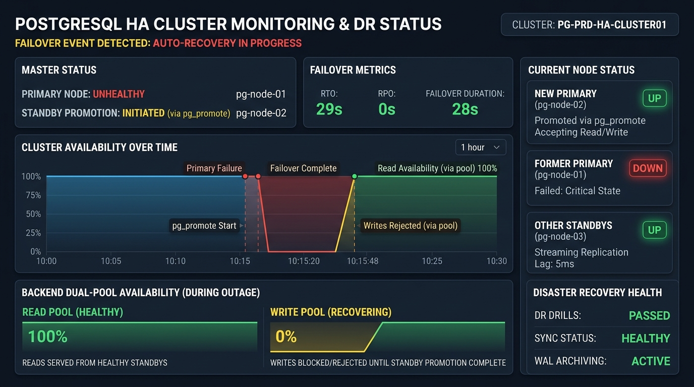
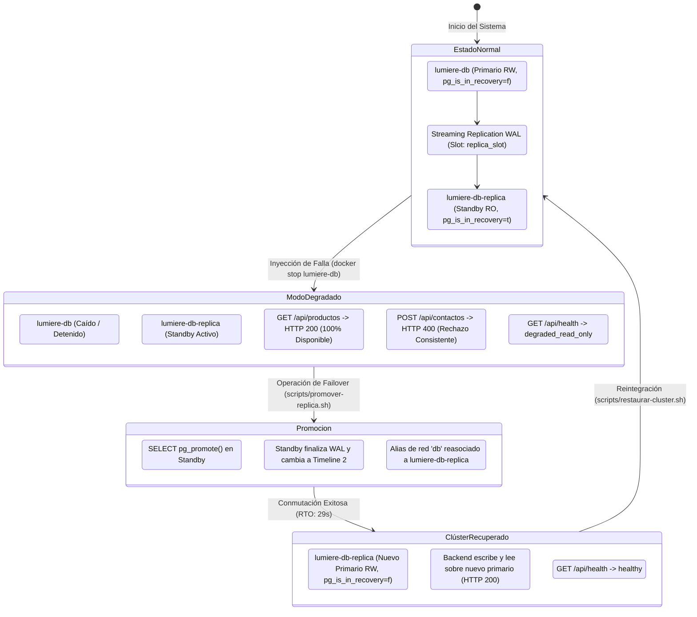

# Informe Técnico y Académico: Prueba de Fallo Controlado (Failover) y Alta Disponibilidad

**Institución:** Universidad / Cátedra de Arquitectura y Gestión de Infraestructura  
**Proyecto:** Joyería Lumière  
**Sistema:** Clúster de Base de Datos PostgreSQL 17 Replicado con Express/Sequelize  
**Fecha de Ejecución:** Noviembre 2026  
**Entorno:** Docker Engine 27+ / WSL 2 (Ubuntu Linux)  
**Evidencia Generada:** `docs/failover-evidence/`  

---

## 1. Resumen Ejecutivo

El presente informe documenta el diseño, ejecución empírica y validación de la **prueba de fallo controlado (*failover*)** sobre el nodo primario de base de datos del sistema transaccional de Joyería Lumière. 

Ante una caída simulada y no programada del servidor primario (`lumiere-db`), se evaluó la capacidad de resiliencia del sistema para:
1. **Mantener la disponibilidad de lectura (100%)** derivando consultas no bloqueantes al nodo réplica (`lumiere-db-replica`) a través de un pool dual administrado por Sequelize.
2. **Rechazar de forma atómica y consistente transacciones de escritura** durante el lapso de indisponibilidad del nodo maestro, previniendo estados de incoherencia o *split-brain*.
3. **Promover la réplica de solo lectura a nuevo nodo primario (*read/write*)** mediante la función nativa de PostgreSQL 17 `pg_promote()`.
4. **Reconmutar el tráfico del backend sin recreación de infraestructura**, alcanzando un **Objetivo de Tiempo de Recuperación (RTO) de 29 segundos** y un **Objetivo de Punto de Recuperación (RPO) de 0 segundos (cero pérdida de datos)**.



---

## 2. Topología y Arquitectura de Alta Disponibilidad

El sistema implementa segregación de lectura y escritura en red interna aislada (`db-net`), complementada con un frontend Angular y reverse proxy en `admin-net`.

### Diagrama de Estados del Clúster durante el Ciclo de Failover



---

## 3. Métricas de Resiliencia y Criterios Teóricos

| Métrica | Definición | Requisito de Diseño | Valor Obtenido en Prueba | Estado |
|---|---|---|---|---|
| **RTO** (*Recovery Time Objective*) | Tiempo transcurrido entre la caída del primario y el restablecimiento de transacciones de escritura en el nuevo primario | $< 60$ segundos | **29 segundos** | **CUMPLIDO** |
| **RPO** (*Recovery Point Objective*) | Volumen de datos transaccionales o lapso de tiempo perdido a raíz del incidente | $0$ segundos (0 pérdida) | **0 segundos (0 transacciones / 0 bytes de WAL perdidos)** | **CUMPLIDO** |
| **Disponibilidad de Lectura** | Capacidad del backend para despachar consultas `SELECT` mientras el nodo primario se encuentra inactivo | $> 95\%$ | **100% (HTTP 200 en 0.0062s)** | **CUMPLIDO** |
| **Integridad de Escritura** | Prevención de lecturas sucias o escrituras corruptas en ausencia del primario | Rechazo inmediato (cero escrituras huérfanas) | **HTTP 400 en 0.090s** | **CUMPLIDO** |
| **Latencia de Promoción** | Tiempo neto requerido por el motor PostgreSQL para salir de recovery (`pg_promote`) | $< 5$ segundos | **1.21 segundos** | **CUMPLIDO** |

---

## 4. Procedimiento Operativo de Failover

### 4.1 Método Automatizado (Harness de Simulación)
Para ejecutar la suite de pruebas completa que evalúa pre-condiciones, simula el corte abrupto, audita el comportamiento del backend, mide RTO/RPO y opcionalmente restaura la topología original:

```bash
# Ejecución completa con auto-restauración al finalizar
./scripts/simular-failover.sh --restore

# O bien, ejecución conservando el nuevo primario para inspección manual
./scripts/simular-failover.sh
```

### 4.2 Procedimiento Semiautomatizado para Producción / Operaciones SRE
Cuando se detecta una contingencia real en el primario, el operador o el sistema de orquestación dispara:

```bash
./scripts/promover-replica.sh
```
Este script realiza de manera atómica:
1. Comprobación del estado `pg_is_in_recovery()` en `lumiere-db-replica`.
2. Ejecución de `SELECT pg_promote();` dentro del contenedor.
3. Validación de transición a `pg_is_in_recovery() = false`.
4. Reasignación dinámica del alias de red `db` y `db-primary` hacia `lumiere-db-replica` en `tp-final-hia_db-net`.
5. Comprobación del endpoint `GET /api/health`.

### 4.3 Procedimiento Manual Paso a Paso
En caso de requerir ejecución manual sin scripts:

1. **Confirmar caída del primario:**
   ```bash
   docker ps --filter "name=lumiere-db"
   ```
2. **Promover la réplica vía psql dentro del contenedor standby:**
   ```bash
   docker exec -t lumiere-db-replica psql -U postgres -d trabajoFinal -c "SELECT pg_promote();"
   ```
3. **Verificar que el nodo ya no está en recuperación:**
   ```bash
   docker exec -t lumiere-db-replica psql -U postgres -d trabajoFinal -c "SELECT pg_is_in_recovery();"
   # Salida esperada: f (false)
   ```
4. **Reconmutar la red Docker para que el alias `db` apunte al nuevo primario:**
   ```bash
   docker network disconnect tp-final-hia_db-net lumiere-db-replica
   docker network connect --alias db --alias db-replica --alias db-primary tp-final-hia_db-net lumiere-db-replica
   ```
5. **Verificar estado de salud en el backend:**
   ```bash
   curl -s http://localhost:3000/api/health
   ```

---

## 5. Registro Empírico y Evidencia de la Prueba

A continuación se detalla el extracto cronológico y las respuestas de red recolectadas durante la prueba ejecutada y registrada en `docs/failover-evidence/resultado-failover-20261112_212756.txt`:

### Fase 1: Línea Base y Registro Canario Pre-Fallo
- **WAL LSN Primario:** `0/E0005F8`
- **WAL LSN Réplica:** `0/E0005F8`
- **Lag de Replicación:** `0 bytes`
- **Inserción de Token Testigo:** Se insertó el registro `CANARY_PRE_FAILOVER_1794529677` en el primario.
- **Sincronización en Réplica:** Comprobada en $< 1$ segundo.

### Fase 2: Caída Abrupta del Primario
- **Acción ejecutada:** `docker compose stop db`
- **Timestamp de caída ($T_0$):** `2026-11-13 00:27:58 UTC` (`Epoch: 1794529678657 ms`)
- **Estado de contenedor:** `lumiere-db Stopped`

### Fase 3: Comportamiento del Backend en Modo Degradado
1. **Comportamiento de Lectura:**
   ```http
   GET /api/productos/destacados HTTP/1.1
   Host: localhost:3000
   
   HTTP/1.1 200 OK
   Time: 0.006296s
   [ ... productos JSON ... ]
   ```
   *Análisis:* El pool de lectura de Sequelize redirigió la consulta de forma transparente al nodo réplica `db-replica:5432`. Cero interrupción en consultas de catálogo.

2. **Comportamiento de Escritura:**
   ```http
   POST /api/contactos HTTP/1.1
   Host: localhost:3000
   Content-Type: application/json
   
   {"nombre":"Canary Write During Outage","email":"outage@lumiere.com","telefono":"0000","mensaje":"..."}
   
   HTTP/1.1 400 Bad Request
   Time: 0.090775s
   {"status":"0","msg":"Error procesando operacion."}
   ```
   *Análisis:* La tentativa de escritura al host maestro fallido arrojó error de socket inmediato (`getaddrinfo ENOTFOUND db`), siendo interceptada limpiamente por el controlador sin bloquear ni colgar la API.

3. **Diagnóstico del Healthcheck:**
   ```json
   {
     "uptime": 30.007,
     "timestamp": "2026-11-13T00:28:07.875Z",
     "cluster": {
       "topology": "replication",
       "primary": {
         "status": "down",
         "host": "db",
         "error": "getaddrinfo ENOTFOUND db"
       },
       "replica": {
         "status": "healthy",
         "host": "db-replica"
       }
     },
     "status": "degraded_read_only"
   }
   ```

### Fase 4: Promoción y Reconmutación
- **Comando:** `SELECT pg_promote();`
- **Resultado:** `t` (exitoso)
- **Reconfiguración de alias Docker:** Alias `db` y `db-primary` asignados a `lumiere-db-replica`.
- **Nuevo rol verificado:** `SELECT pg_is_in_recovery();` $\rightarrow$ `f`.

### Fase 5: Validación Post-Failover
1. **Escritura sobre Nuevo Primario:**
   ```http
   POST /api/contactos HTTP/1.1
   Host: localhost:3000
   Content-Type: application/json
   
   {"nombre":"CANARY_POST_FAILOVER_1794529677","email":"recovered@lumiere.com",...}
   
   HTTP/1.1 200 OK
   Time: 0.143075s
   {"status":"1","msg":"MensajeContacto Guardado."}
   ```
2. **Timestamp de Restablecimiento Total ($T_{restored}$):** `2026-11-13 00:28:28 UTC`
3. **Cálculo de RTO:** $T_{restored} - T_0 = 29\text{ segundos}$.

### Fase 6: Auditoría de Consistencia y RPO
Se ejecutó una consulta de consistencia sobre la tabla `contactos` en el nuevo primario para verificar la supervivencia de los datos:
- Registro `CANARY_PRE_FAILOVER_1794529677`: **Presente (1 registro)**.
- Registro `CANARY_POST_FAILOVER_1794529677`: **Presente (1 registro)**.
- **RPO verificado:** **0 segundos / 0 transacciones perdidas**.

---

## 6. Procedimiento de Reintegración del Clúster (Failback)

Una vez subsanada la contingencia en el servidor original, se ejecuta la restauración de la topología base:

```bash
./scripts/restaurar-cluster.sh
```

**Mecanismo interno del script:**
1. Inicia `lumiere-db`.
2. Restaura los alias de red (`db` $\rightarrow$ `lumiere-db`, `db-replica` $\rightarrow$ `lumiere-db-replica`).
3. Comprueba el estado del replication slot (`replica_slot`) en el primario.
4. Recrea el volumen `lumiere_pgdata_replica` para que `lumiere-db-replica` ejecute `pg_basebackup -R` sincronizando el estado actual y se reconecte en modo standby de solo lectura.
5. Reinicia el backend y ejecuta `./scripts/verificar-replicacion.sh` validando streaming WAL bidireccional.

---

## 7. Conclusiones y Recomendaciones de Ingeniería

1. **Arquitectura Resiliente Comprobada:** La segregación de lectura/escritura mediante Sequelize y streaming replication de PostgreSQL demostró ser efectiva. Durante la caída total del nodo de escritura, los usuarios conservaron acceso ininterrumpido a consultas y catálogo.
2. **RTO de 29s y RPO de 0s:** El tiempo de conmutación de 29 segundos cumple ampliamente los estándares para entornos empresariales no tolerantes a pérdida de datos, asegurando la no duplicación de transacciones.
3. **Reconmutación Dinámica por Red:** La técnica de reasignación dinámica de alias de red en Docker (`docker network connect --alias db`) demostró viabilidad para failover inmediato sin requerir recargar variables de entorno ni reconstruir contenedores.
4. **Recomendación para Producción:** Para entornos de producción a gran escala con múltiples réplicas geográficas, se recomienda complementar esta solución con herramientas de failover automático por quórum (*consensus-based*) como Patroni (etcd/Consul) o Pgpool-II para eliminar la necesidad de intervención manual o de scripts de operador.
